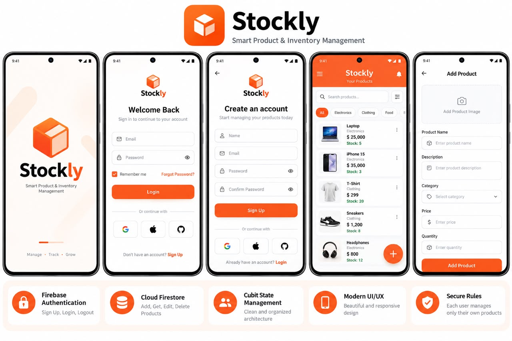
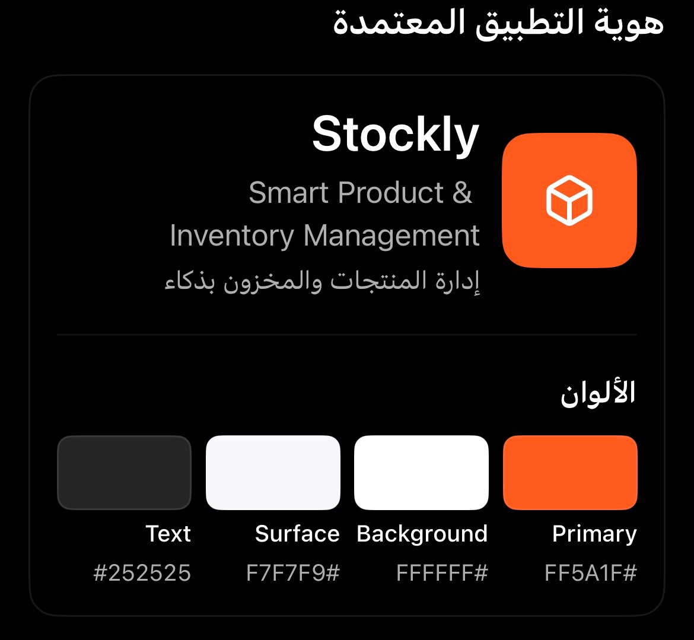
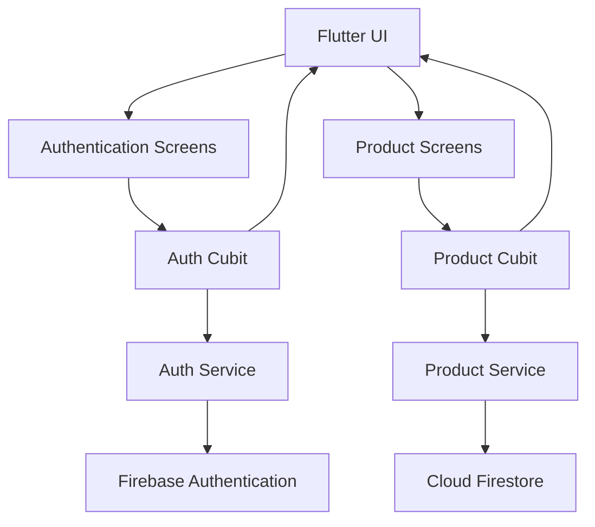

<div align="center">


# Stockly

### Smart Product & Inventory Management

**Manage. Track. Grow.**

A modern Flutter mobile application for managing products, organizing inventory, and keeping product information accessible in one place.

[Features](#-features) · [Architecture](#-architecture) · [Installation](#-getting-started) · [Security](#-security) · [Roadmap](#-roadmap)

<br/>


</div>

---

## 📌 Overview

**Stockly** is a mobile inventory management application built with Flutter and Firebase. It aims to simplify everyday product management through a clean interface and organized inventory workflows.

Users can authenticate, manage product records, search for items, and filter products by category. Firebase Authentication handles account access, while Cloud Firestore stores product information.

The project combines Flutter UI development, Cubit-based state management, and Firebase integration in a practical mobile application.

## ✨ Features

| Feature | Description |
|---|---|
| 🔐 Authentication | Create an account, sign in, and sign out |
| 📦 Product Management | Add, view, edit, and delete product records |
| 🔎 Product Search | Find products by name |
| 🗂️ Category Filtering | Filter products by category |
| ☁️ Cloud Database | Store and retrieve product data with Cloud Firestore |
| 👤 Product Ownership | Associate product records with their authenticated owner |
| 🎨 Modern UI | Consistent orange branding and a clean mobile interface |
| 🔄 State Management | Manage application state using Cubit |

> The documented features describe the current project scope. Features that have not been implemented should not be considered available.

## 📱 App Preview

<div align="center">


</div>

*Design concept for Stockly. The preview illustrates the intended visual direction and may include screens or features that differ from the current implementation.*

## 🎨 Brand Identity

Stockly uses a bold orange accent with light surfaces and dark text to create a clear, consistent visual identity.

| Design Token | Hex Color | Usage |
|---|---|---|
| Primary | `#FF5A1F` | Main actions and brand accents |
| Text | `#252525` | Primary text |
| Surface | `#F7F7F9` | Cards and secondary surfaces |
| Background | `#FFFFFF` | Main screen background |

## 🛠️ Tech Stack

<div align="center">


</div>

- **Flutter:** Mobile UI framework.
- **Dart:** Application programming language.
- **Firebase Authentication:** User authentication.
- **Cloud Firestore:** Cloud-based product data storage.
- **Cubit / flutter_bloc:** State management.
- **FlutterFire:** Integration between Flutter and Firebase.

## 🏗️ Architecture

Stockly separates authentication, product operations, application state, and screen presentation into dedicated areas.



### Architecture Responsibilities

| Component | Responsibility |
|---|---|
| Screens | Display application UI and handle user interactions |
| Auth Cubit | Manage authentication state |
| Auth Service | Communicate with Firebase Authentication |
| Product Cubit | Manage product loading and operation states |
| Product Service | Perform product database operations |
| Product Model | Represent product data |
| Firebase | Provide authentication and cloud data services |

The diagram represents the project's described structure. It should be updated if the implementation or dependencies change.

## 📁 Project Structure

```text
stockly/
├── android/
├── ios/
├── lib/
│   ├── auth/
│   │   ├── auth_cubit.dart
│   │   ├── auth_service.dart
│   │   └── auth_state.dart
│   ├── products/
│   │   ├── product_cubit.dart
│   │   ├── product_model.dart
│   │   ├── product_service.dart
│   │   └── product_state.dart
│   ├── screens/
│   │   ├── auth_gate.dart
│   │   ├── login_screen.dart
│   │   ├── product_form_screen.dart
│   │   ├── product_home_screen.dart
│   │   ├── signup_screen.dart
│   │   └── splash_screen.dart
│   ├── firebase_options.dart
│   └── main.dart
├── assets/
│   └── images/
│       ├── stockly_logo.png
│       └── stockly_preview.png
├── test/
├── pubspec.yaml
└── README.md
```

*The structure above documents the current described organization. Keep it synchronized with the actual files in the repository.*

## 🗃️ Firestore Data Model

Product documents are stored in the `products` collection.

| Field | Type | Description |
|---|---|---|
| `name` | String | Product name |
| `description` | String | Product description |
| `category` | String | Product category |
| `ownerId` | String | Firebase Authentication UID of the owner |
| `price` | Number | Product price |
| `quantity` | Integer | Available quantity |
| `createdAt` | Timestamp | Product creation time |
| `updatedAt` | Timestamp | Last update time |

The application's product model, database operations, and Firestore Security Rules should use consistent field names and types.

## 🚀 Getting Started

### Prerequisites

Install the following tools before running Stockly:

- [Flutter SDK](https://docs.flutter.dev/get-started/install)
- [Android Studio](https://developer.android.com/studio)
- An Android emulator or physical Android device
- A Firebase project

Verify your development environment:

```bash
flutter doctor
```

### 1. Clone the Repository

```bash
git clone <repository-url>
cd stockly
```

If the project is already available locally, open the existing project directory instead.

### 2. Install Dependencies

```bash
flutter pub get
```

### 3. Configure Firebase

1. Open the [Firebase Console](https://console.firebase.google.com/).
2. Select the Firebase project intended for Stockly.
3. Enable **Email/Password** under Authentication sign-in providers.
4. Create a Cloud Firestore database.
5. Register the Android app using the package name configured in the project:

   ```text
   com.stockly.app.stockly
   ```

6. Verify that `lib/firebase_options.dart` and `android/app/google-services.json` belong to the same Firebase project.

If you need to regenerate the FlutterFire configuration, install and run the FlutterFire CLI:

```bash
dart pub global activate flutterfire_cli
dart pub global run flutterfire_cli:flutterfire configure
```

Review the selected Firebase project before accepting configuration changes.

### 4. Configure Firestore Security Rules

Configure and publish rules that restrict product access to authenticated owners and validate product data.

Do not use unrestricted rules such as `allow read, write: if true` in a deployed application.

### 5. Run Stockly

Connect an Android device or start an emulator:

```bash
flutter run
```

## 🔒 Security

Security is an important part of a Firebase-backed inventory application.

- Require authentication for protected product operations.
- Restrict product access according to `ownerId`.
- Validate required fields and data types in Firestore Security Rules.
- Prevent users from changing ownership fields to access another user's records.
- Never commit passwords, service-account private keys, or other sensitive credentials.
- Use test accounts and sample data during development.
- Review Firebase configuration and billing before a production release.

**Important:** Firebase client configuration does not replace database security rules. Security must be enforced on the backend through appropriate Firebase rules.

## 🧪 Testing & Code Quality

Run the following commands when checking the project:

```bash
flutter pub get
flutter analyze
flutter test
```

- `flutter pub get` resolves project dependencies.
- `flutter analyze` checks the code for potential issues.
- `flutter test` runs the automated tests available in the project.

Only report test results after running the commands and verifying their output.

## 🗺️ Roadmap

The following items are potential future improvements, not claims about existing functionality.

- [ ] Low-stock notifications.
- [ ] Inventory statistics and dashboard charts.
- [ ] Product image upload and management.
- [ ] Export product data to CSV or PDF.
- [ ] Advanced sorting and filtering.
- [ ] Automated unit and widget test coverage.
- [ ] Improved accessibility and localization.

## 🤝 Contributing

Contributions, bug reports, and suggestions are welcome.

1. Create a branch for your changes.
2. Keep changes focused and consistent with the existing code.
3. Run the relevant analysis and tests.
4. Verify the affected functionality.
5. Submit a pull request with a clear description of your changes.

## 📄 License

No license has been specified for this project yet. Until a license is added, permission to reuse, modify, or redistribute the code should not be assumed.

---

<div align="center">

### Stockly

**Manage. Track. Grow.**

Built with Flutter and Firebase.

</div>
